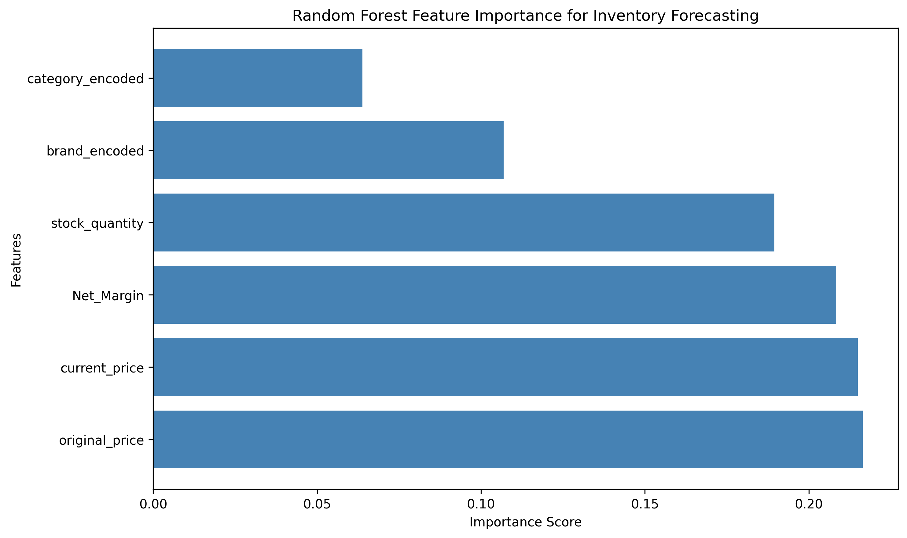

# Smart Atelier

AI-powered stock optimization for fashion boutiques, using machine learning to recommend stock levels and product priority.

<p align="left">
  
  
  
  
</p>

## About

This project is a Proof of Concept (POC) that addresses the challenge of inventory management in the fashion industry. It transforms raw sales and inventory data into actionable insights through a modern web interface.

## Project Structure

-   **`data/`**: Contains raw and processed datasets.
-   **`models/`**: Scripts for training and optimizing ML models, plus saved artifacts.
-   **`src/`**: Data preparation and preprocessing scripts.
-   **`webapp/`**: The full-stack application.
    -   `backend/`: FastAPI server handling AI logic and data serving.
    -   `frontend/`: SvelteKit interface for analysis and prediction.

## Prerequisites

Ensure you have the following installed:
- **Python 3.9+**
- **Node.js (v18+)** and **npm**

## Quick Start

### 1. Backend Setup
Navigate to the backend directory and install the required Python packages:
```bash
cd webapp/backend
pip install pandas scikit-learn joblib fastapi uvicorn pydantic
```

### 2. Frontend Setup
Navigate to the frontend directory and install the dependencies:
```bash
cd webapp/frontend
npm install
```

## Running the App

To run the full system, you need to start both the backend and frontend servers in separate terminal windows.

### Step 1: Start the Backend
```bash
cd webapp/backend
python3 main.py
```
The backend server will start at `http://localhost:8000`. It will automatically load the pre-trained model artifacts from the `models/artifacts/` directory.

### Step 2: Start the Frontend
```bash
cd webapp/frontend
npm run dev
```
The frontend will be available at `http://localhost:5173`.

## Usage

### 1. Stock Optimization Tool
- Go to the **Inventory** page.
- Fill in the item details (Category, Brand, Prices, Current Stock, and recent Sales).
- Open **Advanced Options** to select a specific AI Model (e.g., Random Forest Optimized) and toggle between **Standard** or **Advanced** stocking rules.
- Click **"Get AI Recommendation"** to see the suggested priority (High Stock, Maintain, or Low Stock) along with business insights.

### 2. Analytics Dashboard
- Go to the **Analytics** page.
- Toggle between **Standard** and **Advanced** rulesets to see how they impact the training data distribution.
- Compare the performance of all integrated models (Accuracy, Precision, Recall, F1-Score) through interactive charts.
- Hover over chart elements to see detailed metrics.

## (Optional) Training Models

If you wish to retrain all models (standard and advanced versions):
```bash
python3 models/train_models.py
```
This will update the `.joblib` files in `models/artifacts/` which are used by the backend.

## Results



## Team & Course

**Team**

| Name | Student Number |
| --- | --- |
| [Francisca Portugal](https://github.com/franpts2) | 202303640 |
| [Carolina Ferreira](https://github.com/carolina-ferreira) | 202303547 |
| [Leonor Matias](https://github.com/le0nor) | 202303772 |

**Course**

Developed for **Artificial Intelligence (IA), L.EIC 2025/26** at the Faculty of Engineering of the University of Porto (FEUP).

## License

No license file is included. The source is public for reference; all rights reserved.

---

_Smart Atelier — stock decisions with evidence._
